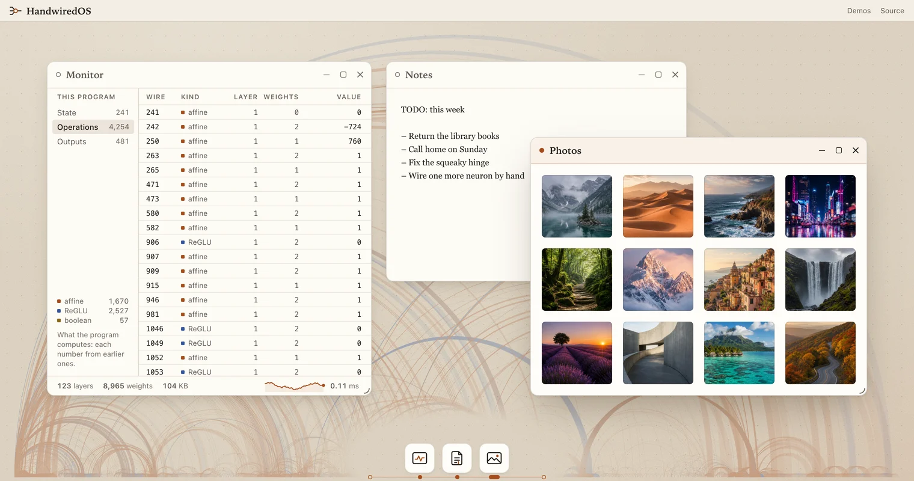

# Handwired

Turn your regular JavaScript code into a neural net; no training & fully differentiable!

## How It Works

A program's made of if-else, loops, and state. Handwired transform them into matrix multiplication + reglu over floats. For example:

```ts
const a = 5
const result = (a > 4) ? 10 : 12
```

The above can be expressed as basic arithmetic:

```ts
const a = 5
// Math.max(0, x) is ReLU. For an integer a, isAbove4 is 1 if a > 4, and 0 otherwise
const isAbove4 = Math.max(0, a - 4) - Math.max(0, a - 5)
// Both branches compute, and isAbove4 picks one
const result = isAbove4 * 10 + (1 - isAbove4) * 12
```

You can calculate that by hand and see that both arrive at the same result.

We then collect the + and * and relu into a giant matmul, and either run it on JS or WebGPU, for fun.

Because we basically only use these 2 promitives:
- the full program stays differentiable
- the weights don't need training since they're written manually
- existing gpu techniques, such as fusion, sparsity, reordering, have a great time optimizing such minimal primitives

This unlocks lots of funny use-cases, like:
- unfreezing the weights and train them (what does that even do? Let's find out!)
- attaching a specific frozen program to a generic neural net and train end-to-end (now a nanoGPT can do both shakespare and your particular UI?)
- achieving GPU-level of parallelism with JS code that was written in a traditional single-threaded way (see the JSON research demo that runs in miliseconds over 100k documents)



## Demos

`bun install`, then `bun start`, serves the demos at http://127.0.0.1:3000/, with an index at / ([Running](#running)):

- [HandwiredOS](#handwiredos), at /os/: a small desktop where one program computes the windows and their springs, the stacking order, which window a press lands on, and a list of the program's own numbers.
- [JSON highlighter](#json-highlighter), at /json-highlighter/: a text box highlighted on every keystroke by one program that keeps no state.
- [Regex search](lab/regex-search/README.md), at /regex-search/: one program finds every match of a pattern in a text as you type, and the same program runs every pattern, since a pattern reaches the program as tables of numbers.
- [Learned gallery](src/learned-gallery/README.md), at /learned-gallery/: a program whose 244 weights are trained instead of wired by hand, by backpropagation in the browser, until the photos match the rectangles you sketch.
- [Search 100,000 JSON documents](src/json-search/README.md#the-demo-page), at /json-search/: at each keystroke, the regex search's program runs once per document over 100,000 JSON documents, or 20,000 in a window narrower than 720 px, in one pass on WebGPU, after the JSON highlighter's program has run over them the same way, for their colors and for a search of only keys or only string values. The page shows each search's time next to native RegExp's for the same search, and a toggle runs the same search on the CPU, where a pattern of up to 7 characters or classes, e.g. `error`, takes about 14 s on an Apple M5 Max.

## HandwiredOS

HandwiredOS is the focus of the repo: a desktop with 3 window slots (Monitor, Notes and Photos) and a dock, run by one compiled program. The program handles focus, stacking, dragging, resizing, the three window controls, closing a window to the dock and reopening it from there, and the springs that animate all of that. Windows and Photos' thumbnails are `emitAnimatedObject`s: each spring keeps its displacement from its destination and its velocity in the source table, and every evaluation applies a step matrix that the host writes, so the program never loops over spring steps. host-timing.ts's `advanceFrame` counts the fixed 4 ms steps, steps the springs to each event's timestamp before applying the event, and with `'events and settle checks'` writes state back only at events, settle checks and snaps, so stored state doesn't depend on the frame rate. A window's content box takes its destination size as soon as an event changes the destination, while only the frame animates and clips the content, so content lays out once per destination change instead of at every in-between size. Presses are hit-tested against destination rectangles rather than drawn ones, with `emitCompare`: the host writes pointer coordinates on a 1/64 px grid and the window geometry is declared on a 1/64 px grid, so each edge comparison is an exact integer bit ([execution-model.md](docs/execution-model.md#comparisons)). The window controls, the dock items, Photos' content, and the rows and the sidebar locations of Monitor's list act on release, like native buttons: a press arms the control under it, a release over the armed control acts, whatever path the pointer took between them, and a release anywhere else or a pointercancel acts on nothing. Every release reaches Photos as a click at the release point, read against Photos' layout at the window's destination, so during a maximize a release at a photo's destination opens that photo even where the drawn frame doesn't cover the point yet. Keys reach a window only while that window is focused: ArrowLeft, ArrowRight and Escape reach Photos, and the six list keys, e.g. PageDown, reach Monitor. A key typed into Notes' text field stays with the browser and never reaches the program, and so does a key held with Command, Control or Alt. Every cell of the source table is declared with cells.ts, which gives each cell its position, range, grid and initial value, and derives the validator that checks the table and the outputs around each evaluation.

Photos has a grid, a lightbox and a spring-animated thumbnail strip, and its photo nodes are attached to the DOM only while the program's size and opacity outputs are positive. Photos is built by `buildPhotos` into the same circuit as the window manager, and so is the list in the Monitor window, so the browser runs one source table, one program and one render loop. Monitor shows the running program itself in a virtualized list, i.e. every source cell (State), every live operation (Operations) and every output (Outputs) with its current value. The list scrolls natively: the page reads the scroller's position at the top of a frame as one more input, and the program computes which row each of 64 DOM slots shows, so the program holds no row ([behavior-choices.md](docs/behavior-choices.md#scroll-a-list-natively-and-select-a-row-at-the-release)). Around the list, the page's JavaScript writes what it reads from the compiled program, e.g. the number of operations of each kind in the sidebar, and the layers and the stored weights in the footer, next to a chart of the program's time per frame as the page measures it, each point the average of 10 frames. Notes holds one native `<textarea>`: the browser edits, selects, wraps and scrolls the text, and the program computes the window around the text, e.g. the window's rectangle and springs, and whether the window is focused. The program holds no text and gets no event for a typed character. In a frame's side effects, the page gives the text field the keyboard focus or takes it away, so that the keyboard focus follows the focused window, e.g. a click on Notes' title bar gives the field the keyboard focus, and a click on another window takes it away (`noteFocusChange` in window-manager.ts).

HandwiredOS compiles to about 4,300 live operations in 123 layers, and one evaluation takes about 25 µs on the CPU executor in Bun, in a process that runs only HandwiredOS. [lab/status.md](lab/status.md) records the exact numbers at each change, and `bun lab/runtime-cost/report.ts` prints the current sizes, and a higher time, about 33 µs, from a process that times 3 programs in a row, which can distort the later timings ([runtime-cost](lab/runtime-cost/README.md)). The page opens the windows at rectangles that its own JavaScript picks for the viewport, e.g. one column on a phone, and writes into the source table before the first step. Files: src/handwiredos/ and, in assets/, index.html, handwired-os.css and photo-gallery-00.webp to photo-gallery-11.webp ([Files](#files) names each module).

## JSON highlighter

The second app in src/ is a monospace text box of up to 2,048 code points, highlighted on every keystroke by one program that keeps no state. JavaScript writes the code points, the text's length and the caret into cells, and the program returns what each character is shown as, e.g. key, string or error, the first error's position and kind, and the bracket that matches the bracket at the caret. The capacity and the maximum depth are parameters of the builder, 512 code points and depth 16 by default and 2,048 and 13 on the page, and a text past the capacity and nesting past the maximum depth each have a named output. The tokenizer and the grammar are state machines read from tables in cells, built in three forms with the same outputs: a loop, which at the page's limits is 63,529 live operations in 4,115 layers, where one evaluation takes about 0.5 ms in Bun and a median of 0.8 ms in the page in headless Chrome (1.2 to 2.3 ms in a third of the runs), and prefix scans over Brent-Kung's and Sklansky's networks, which have fewer layers and take 3 to 8 times the loop's µs in Bun. The tests compare every output with a plain JavaScript reference on 2,509 texts at the default limits, 429 of them for Sklansky's form, and on 3,618 texts at the page's limits, 219 of them for each prefix scan. The highlighter started in lab/ on September 17, 2026 as a demo of a traditional JavaScript task, and moved into src/ on September 18, 2026. [Its README](src/json-search/highlighter/README.md) has the stages, the measurements, and what fit well and what got awkward. Files: highlighter.ts, kinds.ts and tables.ts in src/json-search/highlighter/.

## Running

The repo needs [Bun](https://bun.sh), and its tests and checks were last run with Bun 1.4.3.

```sh
bun install
bun start                                 # the demo site at http://127.0.0.1:3000/: the index, HandwiredOS at /os/ and the other demos beside it
bun run start:template                    # the template app, a toggle switch
bun run test
bun run check
bun run site:build                        # the demo site as static files in site/
bun run site:check                        # builds the site and loads every page in headless Chrome
bun lab/ui-exploration/serve-demos.ts     # every demo except the JSON search, history included, at http://127.0.0.1:4321/
```

`bun start` takes `--port` for another port, and `bun run site:check` needs Chrome, with `CHROME_PATH` for a binary that isn't at the macOS default path.

## The template app

[template/](template/) is a toggle switch written as one numeric program and checked against the same switch in plain JavaScript, to copy as the start of a new app. [tutorial.md](docs/tutorial.md) walks through it: declaring cells, builder code, the host loop, DOM writes, the test, and how to add a second switch or a new app folder.

## How a program is written

A program is a list of instructions of four kinds, and every arithmetic step uses FP32:

```txt
affine  = weighted sum plus offset
reglu   = one affine value times ReLU of another
boolean = a score in 0..1 rounded to an exact bit
index   = the value at floor(index) in a table of earlier values, copied without rounding
```

Builder functions, also called macros, e.g. `emitMinimum` (3 operations) or `emitFirstActive` (a tree over n candidates), expand into instructions before compilation, so they aren't a level of their own. The docs group what you build from instructions by the size of the familiar code it replaces:

- [expressions.md](docs/expressions.md): one expression, e.g. `a >= b`, `Math.min(a, b)` or `table[index]`, where the hard part is an exact FP32 result.
- [patterns.md](docs/patterns.md): a loop, e.g. `findIndex` or `items.sort(compare)`. The program runs every operation on every frame and can't stop early, so a loop becomes a count, a tree, a table, or the same work on every item.
- [behavior-choices.md](docs/behavior-choices.md): a choice that changes what the user sees, e.g. hit-testing where elements are going instead of where they're drawn, to shorten dependency chains, make stored state independent of the frame rate, or keep each frame's work under a fixed maximum.
- Contracts: [execution-model.md](docs/execution-model.md) defines the instructions, the contracts of the builder functions that other docs depend on, e.g. index reads, comparisons, grids, rounding points, springs and time, and each macro's magnitude limits.

Independent instructions share a layer, and today's executor is serial JavaScript on the CPU ([execution-model.md](docs/execution-model.md#compilation)). `bun lab/runtime-cost/report.ts` reports current program sizes and CPU costs; old size and timing tables don't apply to a changed program.

## Reading order

Read this README, then [tutorial.md](docs/tutorial.md), [expressions.md](docs/expressions.md), [patterns.md](docs/patterns.md), [behavior-choices.md](docs/behavior-choices.md), and then [execution-model.md](docs/execution-model.md) for the contracts. [lab/status.md](lab/status.md) has current results, known issues in the production code and open decisions, for people following the research. [The guide](lab/ui-exploration/guide/README.md) has longer explanations that start from the familiar JavaScript, a glossary, and runnable examples checked against plain JavaScript.

## Files

- `src/runtime/numeric-ui-core.ts`: circuit construction, the builder functions, compilation, and the evaluators
- `src/runtime/host-timing.ts`: frame timing, spring step counts and matrices, and the evaluations between frames, computed in host JavaScript
- `src/runtime/cells.ts`: cell declarations, which give each cell its position in the source table, the circuit's declarations, the initial table, a validator, and next values for write-back
- `src/runtime/prefix-networks.ts`: Sklansky's and Brent-Kung's prefix networks, which compute every prefix of a list with any associative combine, e.g. running totals of row heights, or the state after every event of a state machine
- `src/handwiredos/` and `assets/index.html`, with `assets/handwired-os.css` and `assets/photo-gallery-*.webp`: HandwiredOS. `window-manager.ts` builds the window manager and holds the page's render loop. `photo-gallery.ts` (Photos) and `value-list.ts` (the list in the Monitor window) build their parts into the same program. `arrangement.ts` (the windows' first rectangles for the viewport), `monitor-footer.ts` (the footer of the Monitor window, i.e. the program's sizes and the chart of frame times) and `wiring.ts` (the wallpaper) are the page's own JavaScript
- `src/json-search/` and `assets/json-search.html`, with `assets/json-search.css`: the page that searches 100,000 JSON documents. `demo.ts` holds the page's frame, and `searcher.ts` runs the page's two programs once per document, on the GPU or on the CPU. `regex/` holds regex search's program, and `highlighter/` the JSON highlighter's, with `highlighter.ts`, `kinds.ts`, `tables.ts` and a README
- `assets/demos.html`, `assets/demos.css` and `assets/demos-handwiredos.webp`: the index of the demo site. `assets/site.css`: the colors, type sizes, spacing and the parts that every demo page shares, e.g. the page header. `assets/tool.css`: the layout that the pages with a text tool share, e.g. the JSON highlighter's and the regex search's
- `template/`: the toggle switch to start an app from
- `docs/`: the docs above, `tutorial.md`, `expressions.md`, `patterns.md`, `behavior-choices.md` and `execution-model.md`
- `tests/runtime/`: differential tests of the reference and compiled evaluators, including seeded random circuits (`builder-differential`, `numeric-ui-core`, `numeric-semantics`, `random-hardened`), and tests of index reads, gather lowering, comparisons, springs whose matrix the host writes, macro magnitude limits, cell declarations and prefix networks
- `tests/handwiredos/`: tests of HandwiredOS and Photos over scripted traces (`window-manager`, `photo-gallery`, `oracle-trace`), of Monitor's list against the same list in plain JavaScript (`value-list`), of presses and keys where the list and the Notes window meet (`value-list-and-notes`), and of the page's own code, i.e. the rule for the keyboard focus of Notes' text field (in `window-manager`), the windows' first rectangles at many viewport sizes (`arrangement`), Monitor's footer, e.g. the program's size in bytes and the chart's averages (`monitor-footer`), and the wallpaper's arcs and their opacity (`wiring`)
- `tests/json-search/`: tests of the page's parts that need no browser, and of both programs as loops over a document's positions, on the CPU and as GPU code that an interpreter runs. `highlighter/` has the highlighter's three forms against the same highlighter in plain JavaScript (`reference.ts`) over the texts of `corpus.ts`, and that reference against JSON.parse, and `regex/` has regex search's program against two plain JavaScript references
- `scripts/check.ts`, `tsconfig.json`, `package.json`: `bun run check` type-checks and lints src/, tests/, scripts/, the template and each folder directly under lab/ that has a tsconfig.json, and type-checks each lab/ui-exploration prototype through its own tsconfig.json, and lab/ui-exploration/serve-demos.ts through the root one. package.json holds the scripts above. `knip.config.ts`: `bun run knip` reports unused exports in src/, scripts/ and template/
- `scripts/measure-json-highlighter.ts`: the highlighter's sizes and µs per evaluation in Bun
- `scripts/demo-site-pages.ts`, `scripts/serve-demo-site.ts`, `scripts/build-demo-site.ts` and `scripts/check-demo-site.ts`: the demo site, i.e. the list of its pages and their paths, the development server behind `bun start`, the static build into site/ behind `bun run site:build`, and the check of the built site in headless Chrome behind `bun run site:check`. `.github/workflows/pages.yml` runs the build on pushes to main and publishes site/ to GitHub Pages

## History

Everything below is history: every item describes the code as it was when the item was written, and only [lab/status.md](lab/status.md) is kept current. On September 16, 2026, experiments that duplicated root HandwiredOS or each other were removed or merged into the folders that remain, and the [exploration-2026-09 tag](https://github.com/chenglou/handwired/tree/exploration-2026-09) keeps every removed path. The repo was named Indirect, and its desktop IndirectOS, until October 6, 2026. Files at the tag keep the old names in their paths, e.g. `lab/ui-exploration/indirect-os-2`, so links into the tag and mentions of files and folders that exist only at the tag use the old names too.

- `lab/`: learning experiments (learned-interpreter, reusable-layout, user-effort, data-adapter, event-window, generative-fields, cascade-argmax, learned-gallery) and runtime studies (runtime-cost, trace-compiler), each with a README; hard-attend, a page that compares one-hot, direct and softmax gathers; candidate-gallery, where three photo layouts are scored while running and a balanced argmax picks one; regex-search, a demo of a traditional JavaScript task from September 17, 2026, where one program searches a text with a pattern as you type; json-search, the measurements of October 13 and 14, 2026 of the JSON highlighter's and regex search's programs over 100,000 documents on WebGPU, whose page and code moved into src/json-search on October 14, 2026; knuth-plass, Knuth-Plass line breaking as min-plus matrix products, timed on the CPU and on WebGPU, from September 17, 2026; `lab/research-sweep.md`, the changes landed in July 2026, and superseded experiments; `lab/reassessment-2026-09-03.md`, the September 3, 2026 review of the July results; and `lab/briefs/`, the July 2026 briefs. Six have a start script for their page: `bun run start:reusable`, `bun run start:learning` (learned-gallery, a small geometry network trained with backpropagation), `bun run start:hard-attend`, `bun run start:candidates`, `bun run start:regex-search` and `bun run start:knuth-plass`. learned-gallery, hard-attend and research-sweep.md moved from the repo root on September 16, 2026, candidate-gallery moved from the repo root on September 17, 2026, json-highlighter, a demo like regex-search, moved from lab/ into src/ on September 18, 2026, and the earliest experiments, in `exp/`, moved into lab/event-window and lab/ui-exploration/learned-bits or were removed.
- `lab/ui-exploration/`: the record of the September 12-14, 2026 exploration of how far circuit UI goes, i.e. prototypes built on the runtime of that time or on copies of it, and the guide. 16 of the 24 prototypes remain, and the other 8 and the notes were removed or merged into the remaining ones on September 16, 2026. Its measurements describe the code as it was then. On September 17, 2026, lists gained text rows, a temporary demo of a traditional JavaScript task: a list of chat messages whose heights come from pretext, and text-walker gained many paragraphs at once, on the CPU and on WebGPU.

## License

MIT, see [LICENSE](LICENSE).
