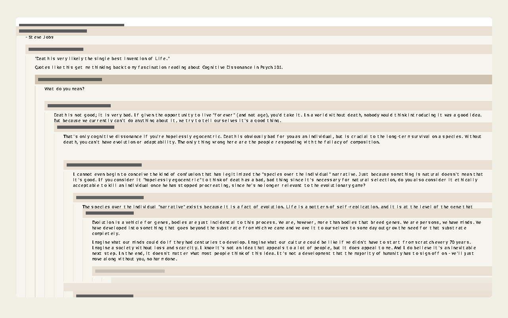

# HN thread drawn per pixel

## What it is and how to run it

hn-thread routes the rows in view into 48 DOM slots, and that router costs 25,616 of the circuit's 53,703 live operations and 134,366 of its 218,170 stored weights. The DOM then lays the comment text out a second time from `innerHTML`, and that layout can be a line off pretext's. This prototype draws the same thread per pixel instead, with no slots and no DOM text. It answers two questions: do the slot router and the second layout exist only because the output is the DOM, and what does a per-pixel program over a text-heavy UI cost?

The thread circuit is hn-thread's, built with no slot section and with two more source cells, `pixelX` and `pixelY`. A per-pixel program reads the thread's per-row outputs (row tops, sticky banner rectangles, comment boxes, gutter extents, emphasis and collapse bits) and computes one pixel's color, paint layer, row and emphasis bit. codegen's `planInstances`, given the two pixel cells, separates the thread logic, which runs once per frame, from the per-pixel part, which runs once per pixel on the CPU or in a WGSL shader.

Commands, from the repo root:

- `bun test lab/ui-exploration/pixel-output`: 8 tests, about 2 to 3 seconds.
- `bunx tsgo -p lab/ui-exploration/pixel-output`: typecheck.
- `bun lab/ui-exploration/pixel-output/report.ts`: counts, CPU times, random states, the scripted session, and the WGSL interpreter check, written to `results.json`, about 2 minutes. One section at a time: `report.ts counts`, `cpu`, `random [frames]`, `session`, `wgsl`.
- GPU, three steps with a directory of your choice:
  - `bun lab/ui-exploration/pixel-output/report.ts gpu-export <directory>` writes shaders and shared buffers.
  - `deno run --unstable-webgpu --allow-all lab/ui-exploration/pixel-output/gpu-headless.ts <directory>` runs them through wgpu. A cold compile of the count version's shaders took from 1.9 to 75 seconds, depending on what else was running on the machine.
  - `bun lab/ui-exploration/pixel-output/report.ts gpu-compare <directory>` compares the GPU outputs with the CPU and the float64 rasterizer, checks that each state has emphasized samples to compare, adds a section to `results.json`, and writes `gpu-frame-glyphs.png` from the animated state's GPU glyph output.
  - `DAWN_WEBGPU=<path to webgpu/index.js> node lab/ui-exploration/pixel-output/gpu-headless.ts <directory>` should do the same through Dawn, but it crashes; see below.
- `bun lab/ui-exploration/pixel-output/demo.html`: the browser demo. It bundles (`bun build lab/ui-exploration/pixel-output/demo.html --outdir <scratch folder>`, 0.53 MB), but nobody has opened it in a browser. A later Chrome check opened the demo, see [Browser check](#browser-check).
- `swift lab/ui-exploration/pixel-output/glyph-atlas.swift Verdana 10 < characters.json > glyph-atlas.json` renders the headless glyph atlas with CoreText. `characters.json` is a JSON array of the thread's characters.

The runtime is index-read's modified `numeric-ui-core.ts` (the root runtime plus the `indexRead` instruction, one-hot recognition, and bit provenance), imported from index-read (until September 15, 2026 this folder held an unchanged copy). Every program here is compiled with `{lowerIndexOneHots: false, inferBitFamilies: false, recomputeDepths: false}`, which turns index-read's compile passes off, so everything except index reads behaves like the shared runtime. With those options this runtime gives hn-thread's exact counts (53,703 live operations, 69 layers, 218,170 stored weights with 48 slots; 28,340, 68 and 84,308 with none), and a test checks it.

| File | What it holds |
| --- | --- |
| hn-thread's `hn-data.ts`, `comment-doc.ts`, `fake-canvas.ts`, `pretext/`, `text-heights.ts`, `thread-model.ts` | Imported from hn-thread (until September 15, 2026 this folder held unchanged copies): data, parsing, pretext, breakpoints |
| `thread-prepare.ts`, `differential.ts` | Copied from hn-thread unchanged except for import paths: preparation, random states and the scripted session |
| `thread-frame.ts`, `thread-circuit.ts` | Copied from hn-thread, with slot mode `'none'`, extra source cells, and the exported wires a per-pixel program reads |
| `pixel-model.ts` | Colors, paint layers, bar geometry, banner label and header widths |
| `pixel-circuit.ts` | The per-pixel program: container, header, row lookup, banner, text, gutters, layer, color |
| `text-table.ts` | The glyph atlas loader, and pretext's lines at a container width as tables |
| `pixel-machine.ts` | Build, compile, instance plan, frame loop with state writeback, text table rewrites on width changes |
| `pixel-reference.ts` | The float64 painter's rasterizer and the comparison |
| `codegen.ts`, `instance.ts`, `wgsl.ts`, `wgsl-interpreter.ts`, `gpu-runner.ts` | Copied from codegen, with index reads added (and a fragment stage, and chunked uploads) |
| `gpu-cases.ts`, `gpu-headless.ts` | GPU export and comparison in Bun, and the GPU run in Deno or Node |
| `report.ts`, `results.json`, `pixel.test.ts` | Measurements and tests |
| `demo.html`, `demo.ts`, `demo.css`, `demo-model.ts` | The browser demo; its logic is in `demo-model.ts` |
| `glyph-atlas.swift`, `glyph-atlas.json`, `png.ts`, `gpu-frame-glyphs.png` | Atlas rendering, a PNG encoder, and one frame from the GPU |

## What was built

### The picture

The per-pixel program draws what hn-thread's demo builds in the DOM, as rectangles: the white container with 8px rounded corners, the submission header's two lines, the scroller background, and per row a sticky banner (z-index 1) with its label over the comment text, then the gutter lines the demo strokes on a canvas above everything, 1px wide at `indent × 24`, with level-0 lines stopping 8px above the container's bottom. A banner's color follows its emphasis bit and blends by `userOpacity`; its label blends by the clamped `userTextOpacity`. Box shadows, the header's mask and the comments' bottom fade are not drawn. Coverage is binary at the pixel center, with no antialiasing.

Text comes in two forms:

- **Bars**: one gray bar per 14px line, rows 3 to 11 of each line, across the comment box and down to the comment's text height. This ignores the 8px gaps between paragraphs.
- **Glyphs**: pretext's real lines. JS lays every comment out with pretext when the container width changes, and writes the lines into source cells: per comment its first line and line count, per line its top, first character and length, per character a glyph code and its x in the line (quantized to 1/64px). The atlas is 97 glyphs of 12×14px, rendered with CoreText (Verdana 10px, ink where coverage is at least 50%), and every character of the thread has a glyph. `layoutTextTables` checks that the lines of every comment add up to pretext's height, which is also the circuit's breakpoint height. The header and the banner labels are still bars in this version.

### Finding the row under the pixel

Row tops are sorted when every row's height is nonnegative, so the row under a pixel is the last row whose top is at or above it. There are two versions:

- **Count** (what the shared runtime can do): per pixel, one comparison `[top_r <= y]` for each of the 251 rows, the row index as their count, and a one-hot of the row as the difference of neighboring bits. Row fields are masked sums over that one-hot, which the compiler lowers to gather reads. For gutters, a pixel's column picks an indent level through a second one-hot of 11 column bits, and each level reads its gutter owner's fields through the row one-hot: the owner of row r at level l is hn.js' ancestor at that level when its indent is exactly l, otherwise nothing is drawn there.
- **Binary search** (index-read's instruction): 8 index reads over the 252 row tops (the last entry is the end of the last row), each followed by one comparison and an addition. The row's fields are then direct index reads. Static per-row numbers (indent width, label widths, the gutter owner table of 251 × 11 entries) live in source cells. For glyphs, a second binary search of 9 probes over this comment's line tops finds the line, a third of 8 probes over that line's character x positions finds the character, and one read at `code × 168 + glyph row × 12 + glyph column` gets the atlas bit. Every probe reads `min(low + step, count - 1)`, so it never leaves the comment's lines or the line's characters. Floors are `round(t) - [round(t) > t]`, since `round` alone gets exact integers wrong half the time (it rounds `t - 0.5` to even).

Both versions give the same outputs bit for bit on sorted row tops, because every field they read holds the same FP32 value and the arithmetic after the reads is identical.

### Index reads in codegen

`flattenProgram` now reads the runtime copy's evenly spaced candidate tables (a base and a stride instead of a position list) and emits an `index` row: the index form as the row's own sum, and the candidate positions. Generated JS reads `table[Math.min(Math.max(Math.floor(index), 0), last)]`. WGSL computes the index form as a guarded sum like any other row, floors it into an `i32`, clamps it, and reads `shared_values[u32(p) * stride + base]`. Candidate lists that aren't evenly spaced are copied into the shared buffer after the lowest value, once per distinct list. The WGSL interpreter learned `floor`, `u32`, `<` and `>`. Only reads that clamp outside the table are emitted, which is all these programs use.

`wgsl.ts` also has a fragment stage for the demo: the same body, with the pixel cells from `@builtin(position)` times a scale and the first three outputs returned as the color. A test checks that its value lines equal the compute shader's.

### The references

`pixel-reference.ts` is a painter's algorithm over rectangle lists in float64: the container, header bars, scroller, then for each row in order its text bars or glyph boxes, banner and label, then every visible gutter, with later rectangles painting over earlier ones. The row under a scanline is the number of sorted row tops at or above it, minus 1. For glyphs, each character owns the pixels from its own x to the next character's x, and paints its atlas cell there. A sample is ambiguous when its center is within a band of an edge of a painted rectangle, a corner arc, a row top, or a glyph row boundary.

It runs in two ways:

- **End to end**: geometry from thread-frame.ts's float64 reference frame (hn.js' control flow and pretext's heights), band 0.05px, since positions drift up to 0.026px from float64.
- **Per-pixel part only**: geometry from the circuit's own FP32 per-row values, band 1/32px.

Layer, row and emphasis must match outside the band. Colors are compared where those match. With glyph text, a sample is also ambiguous when it's within the band of a glyph row boundary, so a 0.5px band hides every ink sample of a line whose top isn't on a whole pixel; the Checks table says how many ink samples each comparison compared. Other checks: sampled pixels through the reference evaluator, the emitted WGSL interpreted with strict f32 rounding, and GPU bits against the CPU instance loop.

### Frame loop and demo

`pixel-machine.ts` writes inputs, rewrites the text tables if the container width changed, runs the shared part, runs every pixel center, and writes the next state back. `demo.ts` does the same per animation frame: WebGPU draws a full-screen triangle whose fragment shader is the per-pixel program, and the CPU fallback draws every 2nd CSS pixel through generated JS. The wheel scrolls (clamped to the placeholder height), hovering a gutter emphasizes it, pressing a gutter peeks, and clicking a banner collapses a comment. In the browser, pretext measures with the real canvas and the atlas is rendered by the browser's own canvas at 11px.

## Measured results

Counts are exact. Times are rough: other agents shared the machine, and the same measurement moved by up to 2× between runs. Ranges cover the report runs and the scratch scripts that measured the same thing.

### What disappears with the slots, 251 comments

| Thread circuit | Live operations | Layers | Stored weights | Slot section: operations | Slot section: weights |
| --- | ---: | ---: | ---: | ---: | ---: |
| 48 rank slots, every per-row output (hn-thread's default) | 53,703 | 69 | 218,170 | 25,616 | 134,366 |
| slot count 0, every per-row output (hn-thread's "no slots") | 28,340 | 68 | 84,308 | 253 | 504 |
| slot mode `'none'`, every per-row output | 28,087 | 65 | 83,804 | 0 | 0 |
| what the pixel programs keep of the thread (the count version's shared part) | 23,315 rows | | 77,021 | 0 | 0 |

The pixel programs keep less than 28,087 because their roots are the next state, 7 globals for JS, and the pixel outputs: per-row outputs that only fed DOM styles, like `visible`, `occupiesSlot` and `commentFadeSize`, are removed. The "visual rows and gutters" section goes from 13,805 operations in hn-thread to 9,036.

### Pixel programs, 251 comments

| Variant | Source cells | Live operations | Layers | Stored weights | Per-pixel rows | Per-pixel weights | Per-pixel layers | Per-pixel comparisons | Index reads: all / per pixel | Gather reads | Guarded shader: statements | KB | Guards |
| --- | ---: | ---: | ---: | ---: | ---: | ---: | ---: | ---: | ---: | ---: | ---: | ---: | ---: |
| count, bars | 1,017 | 24,930 | 74 | 80,177 | 1,615 | 3,156 | 24 | 307 | 0 / 0 | 64 | 15,088 | 1,165 | 29,369 |
| binary search, bars | 4,531 | 23,630 | 102 | 77,554 | 314 | 532 | 54 | 55 | 25 / 24 | 7 | 346 | 22 | 385 |
| binary search, glyphs | 212,288 | 23,771 | 196 | 77,861 | 455 | 839 | 148 | 76 | 50 / 49 | 7 | 512 | 35 | 632 |

The binary search's first probe reads `tops[128]`, an index that doesn't depend on the pixel, so it runs once per frame with the thread logic. That's why the binary-search versions have one more shared row than the count version (23,316 rows and 77,022 weights, against 23,315 and 77,021) and one index read that isn't per pixel. "Per-pixel comparisons" counts every comparison of the per-pixel program: container, header, row search, banner, label, gutters and text. The 7 gather reads of the binary-search versions belong to the thread logic (hit test, peek, cursor). The count version's other 57 are per pixel: 53 over the row one-hot and 4 over the indent level. In WGSL each is a `switch`, 251 cases for a row read and 11 for a level read, and those switches are most of the count version's 1.17 MB shader. Per-pixel layers are the longest chain of per-pixel rows; the "layers" column is the whole program with build-time depths.

Per-pixel rows by comment count, bars:

| Comments | Deepest indent | Count: per-pixel rows | Binary search: per-pixel rows |
| ---: | ---: | ---: | ---: |
| 60 | 8 | 634 | 306 |
| 120 | 10 | 960 | 314 |
| 180 | 10 | 1,260 | 314 |
| 251 | 10 | 1,615 | 314 |

The count version adds about 5 operations per row per pixel. The binary search has 8 probes, which reach 256 rows (the builder throws for more), so past that it needs one more probe per doubling of the row count. Its 8 more rows between 60 and 120 comments come from 2 more indent levels, since the pixel's gutter level is a count of one column comparison per level.

Glyph text tables at a few container widths (capacity 2,793 lines and 91,290 characters; the searches reach 511 lines per comment and 255 characters per line):

| Container width | Lines | Characters | Most lines in one comment | Most characters in one line |
| ---: | ---: | ---: | ---: | ---: |
| 375 | 2,599 | 89,249 | 257 | 58 |
| 1,024 | 881 | 89,249 | 38 | 168 |
| 1,200 | 794 | 89,249 | 34 | 197 |

Laying the tables out with pretext takes 11 to 22ms per container width change.

### Checks

| Check | Frames | Samples per frame | Result |
| --- | ---: | ---: | --- |
| Random states (hn-thread's `randomState` and `randomInputs`: collapses, peeks, mid-animation heights, stale widths), every variant, 320×200 samples of a 1280×800 frame | 60 per variant | 64,000 | In the 40 frames where every row height is nonnegative: 0 decision mismatches end to end (0.05px band) and per-pixel only (1/32px band). End to end, 15,210 samples were ambiguous for bars and 76,156 for glyphs, none of them mismatched, and colors agreed within 1.3e-5. Comment ink samples compared end to end: 234,232 of 239,118 for bars, 33,771 of 41,055 for glyphs. Emphasis is rare at this sampling: emphasized gutter samples in 2 of the 40 frames, emphasized banners in none. In the other 20 frames: 1,728 decision mismatches per variant (below) |
| Count against binary search, the same random frames with sorted tops | 40 | 64,000 × 6 outputs | identical bits |
| hn-thread's scripted session (scroll, a level-1 gutter press, collapse and expand, resize from 1,024 to about 500px, overscroll), closed loop, every 5th frame rasterized, end to end with a 0.5px band (the two sides run on their own state and drift apart) and per-pixel only with a 1/32px band | 300, 60 rasterized, per variant | 64,000 | 0 decision mismatches in both comparisons. 523 samples differed inside the band. Comment ink samples compared: for bars, 617,132 of 752,943 end to end and 750,900 per-pixel only; for glyphs, 28,353 of 113,689 (25%) end to end and 109,336 (96%) per-pixel only. Emphasized banners in 8 and emphasized gutters in 18 of the 60 rasterized frames. The container width changed 55 times, and every text table rewrite matched the circuit's heights |
| GPU through wgpu with the max guard, every variant, 2 states: settled with the pointer on a level-2 gutter column, which emphasizes that gutter, and a random animated state pressing a level-2 gutter, which emphasizes the pressed comment's banner and gutter | 2 per variant | 1,024,000 | 0 of 6,144,000 outputs differ from the CPU instance loop, and 0 decision mismatches against the rasterizer (0 and 24 ambiguous samples). The outputs have 620 emphasized gutter samples in the settled state, and 27,648 emphasized banner or label samples and 532 emphasized gutter samples in the animated state; `gpu-compare` throws if a state has none |
| WGSL interpreted with strict f32 rounding, both guards, every variant | 1 per variant | 2,560 | 0 of 15,360 outputs differ |
| Reference evaluator (the circuit interpreted operation by operation) against the generated instance loop, every variant, a gutter press on the 60-comment thread | 1 per variant | 30: the first 3 samples of each of the 8 paint layers, and 2 emphasized samples each on a banner, a label and a gutter | identical outputs |

The 20 random frames with a negative row height come from hn-thread's resize extension: when the container width changes, a row animating at 0px shifts by the change of its natural height and can go below 0. Row tops are then not sorted. The painter's rasterizer lets a later row paint over an earlier one, while both lookups assume sorted tops, so decisions differ, e.g. "circuit layer 3 row 237, reference layer 5 row 237" where the reference painted an overlapping row's banner. The two lookups also differ from each other there. hn-thread's scripted session never produced a negative height.

### CPU, generated JS instance loop

320×200 samples of a 1280×800 frame, blocks of 1,024 pixels, median of 9 frames after warmup:

| Variant | First frame ms | Frame ms | Thread logic ms | ns per pixel |
| --- | ---: | ---: | ---: | ---: |
| count, bars | 1,189 | 164 to 266 | 3.0 | about 2,500 to 4,100 |
| binary search, bars | 213 | 23 to 30 | 3.1 | about 310 to 420 |
| binary search, glyphs | 375 | 43 to 136 | 2.9 | about 630 to 2,100 |

At the full 1280×800 (1,024,000 pixels): count 2.1 to 4.1s, binary search with bars 166 to 267ms, glyphs 304 to 503ms.

### GPU, wgpu (Deno 1.42.4, Apple GPU through Metal)

1280×800, median of 7 runs of: upload the shared values, dispatch, read back 6 outputs per pixel. Pixel centers were uploaded once before. Frame times cover two runs with the current states and the earlier runs with other states.

The system keeps a shader cache across processes, so compiling the same text again is much faster, and an earlier version of this table didn't say which compiles were cold. `gpu-headless.ts` now renames one local and adds an unused `let` with a token unique to each run, so "cold" is the first compile of that text, and "warm" compiles the same text a second time in the same process. Two cold runs of the current version agreed within 1% (count shaders 1.9 and 4.6s). The larger cold times are from earlier runs of the same shader text while other agents shared the machine; I didn't find out why they were up to 16 times slower.

| Variant | Guard | Frame ms with readback | Cold compile | Warm compile | Outputs differing from the CPU, settled / animated state (largest difference) |
| --- | --- | ---: | ---: | ---: | --- |
| count, bars | none | 58 to 70 | 1.9 to 23.0s | 283 to 288ms | 1,245,968 / 665,152 (53) |
| count, bars | max | 63 to 66 | 4.6 to 75.3s | 391 to 411ms | 0 / 0 |
| binary search, bars | none | 16 to 48 | 19 to 340ms | 2.2 to 2.5ms | 1,245,968 / 665,152 (53) |
| binary search, bars | max | 16 to 20 | 34 to 158ms | 3.4 to 3.9ms | 0 / 0 |
| binary search, glyphs | none | 17 to 19 | 34 to 147ms | 4.1 to 4.4ms | 199,440 / 135,924 (218) |
| binary search, glyphs | max | 16 to 19 | 40 to 151ms | 4.9 to 5.2ms | 0 / 0 |

Without the guard, a large share of pixels is wrong: for bars, 311,492 and 165,948 of the 1,024,000 samples get a wrong layer, row or emphasis decision in the two states, and for glyphs 49,860 and 33,641. That's the boolean atom `(x + 8388609) - 8388609` folded to `x`, as codegen found. The same runs without the readback, waiting on `onSubmittedWorkDone`, measured 0.1 to 1ms, which is less than the dispatch can take, so Deno's promise probably resolves before the GPU finishes, and those numbers aren't usable. Most of the 16 to 20ms is probably the 24 MB readback.

**Dawn** (Node 23.10 with `webgpu` 0.6.1) crashed in `gpu-headless.ts` before finishing the first case: once with `mutex lock failed: Invalid argument` (exit 134), then twice with exit 139, the second time after splitting the 8 MB pixel center upload into 1 MB `writeBuffer` calls. Bisect scripts (the session scratch files `dawn-bisect.mjs` and `dawn-bisect-runner.mjs` in scratch folder `phase3/pixel-output/`, not in the repo) narrowed it to the upload in `setInstanceSources`. A stripped-down script that creates the same buffers and writes the whole array at once ran the binary-search shader and read back the correct first pixel (page color, layer 0, row -1), but the same script without the device limits crashed at that upload. I didn't find the cause.

## What this shows about how far the approach goes

### What fit well

- **The slot router is an artifact of the DOM.** With pixels as the output, nothing routes rows into slots: a pixel finds its own row. The thread logic the pixels need is 23,315 rows and 77,021 weights, against 53,703 operations and 218,170 weights with 48 DOM slots, and the per-pixel part is written once and runs for every pixel: 314 rows with index reads, 1,615 with counts.
- **So is the second layout.** Glyphs are drawn from pretext's lines, and those lines add up to the same heights the circuit gets from its breakpoints, checked at every width change of the random frames and the session. No `innerHTML` text can be a line off. Real text per pixel costs 141 more per-pixel rows than bars, and 16 to 19ms per 1280×800 frame on the GPU with readback.
- **The split into thread logic and per-pixel work needed no new concepts.** `planInstances` with two source cells separated them automatically, the way a shader separates uniforms from per-fragment values: 23,315 rows of thread logic run once (plus the binary search's first probe, which doesn't depend on the pixel), and 314 to 1,615 rows run per pixel.
- **Index reads make the per-pixel cost grow with the logarithm of the row count instead of the row count.** A binary search over row tops is 8 reads for up to 256 rows, so from 120 to 251 comments its per-pixel rows stay at 314, while the count version goes from 960 to 1,615, about 5 operations per row per pixel. The binary search still grows with the deepest indent (306 rows at 60 comments, whose deepest indent is 8), and past 256 rows it needs one more probe per doubling. Once reads are cheap, a pixel can afford three nested searches (row, line, character) and an atlas read, which is what drawing text needs.
- **Exact decisions held wherever row tops are sorted.** 0 decision mismatches over 40 random frames per variant, 60 rasterized session frames per variant, and 2 full-resolution GPU states per variant with a hovered gutter and a pressed comment in the window, against an independent painter's rasterizer, with the count and binary-search versions identical bit for bit.
- **WGSL stayed exact through two new constructions.** Index reads as floored guarded sums plus clamped storage-buffer reads, and 251-case gather switches, both matched the CPU bit for bit on the GPU with the guard.

### What got awkward

- **Counting rows per pixel is the approach's usual O(n) width, multiplied by pixels.** 307 comparisons and 57 gathers per pixel make a 15,088-statement shader whose guarded version took 4.6 to 75 seconds to compile cold (0.4s when the system shader cache already has the text), and a CPU frame of 2.1 to 4.1s at 1280×800. The binary search needs the index read instruction, a fourth runtime instruction.
- **Searches are deep.** Glyph text has 148 per-pixel layers, mostly probes that wait on the previous probe. A GPU shader doesn't care about layers, but a layer-parallel executor would. Pointer jumping (index-read) is the known way to trade width back for depth.
- **Both lookups assume sorted row tops**, and hn-thread's resize extension can make a row's height negative. That happened in 20 of 60 random frames, and 1,728 decisions differed from the painter's order in each variant. Clamping heights at 0 in the thread logic, or a per-pixel program that handles overlapping rows, would be needed before trusting either lookup in every state.
- **The guard is load-bearing.** Without it, 1,245,968 of 6,144,000 outputs are wrong in the settled state with bars. With it, the per-pixel part has about one `max` per row, and it relies on the Metal compiler not seeing through a runtime value.
- **The source table got big.** Glyph text adds 207,757 source cells (text tables and the atlas), copied into the shared values every frame and uploaded to the GPU with them. Table capacities, 511 lines per comment and 255 characters per line, are fixed at build time.
- **Floors cost a comparison each.** A correct floor is `round(t) - [round(t) > t]`, 4 more operations than a rounding.
- **GPU timing and Dawn.** Timing a dispatch without readback didn't work through Deno, and Dawn's Node bindings crashed on the upload, so every GPU number comes from one implementation.

### What stayed outside the circuit

- **Pretext's line layout at the current width**, in JS, 11 to 22ms per container width change. The circuit keeps computing heights from breakpoints and never waits on JS for them, but the glyph positions come from JS tables.
- **Glyph rasterization**: CoreText headlessly, the browser's canvas in the demo, and the character-to-glyph code assignment in JS.
- **The header and banner labels**, which are still bars; they'd need the same character search over static label tables.
- **Everything text is for besides looking at it**: links, selection, copy, search, and the cursor shape inside text. The circuit outputs one cursor code for the whole thread.
- **Antialiasing, shadows and masks.** Coverage is binary at pixel centers.
- **Reading outputs back for the checks.** A real display would keep the outputs on the GPU, as the demo's fragment shader does.

## How it connects to the talk

The talk quotes Ken Perlin: "why don't we just put one supercomputer behind every pixel". A DOM slot is a unit the circuit had to route rows into: 48 slots, each needing a member for every comment. The pixel is a smaller and homogeneous unit. Going down to it removed the router, because every pixel runs the same program and finds its own row, and removed the second layout, because the pixels draw the lines pretext computed instead of handing text to the DOM.

The granularity gap shows up in the program itself: a pixel's program knows nothing about comments or paragraphs, only how to search tables of tops and x positions and read a bit from an atlas. Text still appears. The talk's "we read letters as pixels" is literal here: the glyph version's per-pixel program, which draws the container, header, banners, gutters and comment text, is 49 index reads and 76 comparisons per pixel.

Homogeneity is what made directing it uniform: one compiled program, split automatically into what runs once and what runs per pixel, ran on the CPU and on the GPU with identical bits. The cost moved to where the talk says to accept it, a large quantity of tiny evaluations (a million per frame), and away from hand-written routing.

## Open questions and next steps

- Draw the header and banner labels as glyphs with a character search over static label tables, and take character x positions from pretext's segment widths instead of per-character measurement, which differs by kerning in real browsers.
- Handle unsorted row tops, e.g. clamp heights at 0 in hn-thread's resize shift, and measure whether hn.js' own peek (a negative target height when the ancestor is scrolled far above) still unsorts rows.
- Move line layout into the circuit. text-walker runs pretext's walker as arithmetic over runtime widths, but at 89,249 characters that's far beyond these programs; tabulating line starts as breakpoints was not measured.
- Read hit tests from the pixels. The thread logic still hit-tests rows with its own comparisons; a per-pixel owner map, like codegen's press map, could feed pointer decisions instead.
- Antialiased coverage from distances to edges, instead of binary coverage at pixel centers.
- The fragment shader path and the demo have not run on a GPU or in a browser. A later Chrome check ran the demo's fragment shader through WebGPU, see [Browser check](#browser-check). Dawn's crash on large uploads is unexplained.
- Integer values in WGSL (`i32` rows for integer decisions) would make those rows exact without a guard.

## Browser check

2026-09-13, Chrome, in a hidden tab with a 1,160 by 853 CSS px viewport at devicePixelRatio 2, served with `bun lab/ui-exploration/pixel-output/demo.html`. `navigator.gpu` was available. The hidden tab didn't render frames on its own, so a console script replaced `requestAnimationFrame` with a Worker timer every 16 ms.

- Doesn't draw. The first frame throws "RangeError: Maximum call stack size exceeded" from the call to a generated function in `runShared` (`instance.ts`), before either backend draws, and Bun's error overlay covers the page. "index reads, gray bars" throws the same way. The fragment shader compiled without a validation error both times, since the backend stayed on WebGPU.
- Cause: `sumExpression` rounds the running sum before adding each next term, e.g. `f(f(f(v[1] + v[2]) + v[3]) + v[4])`, so a row with about 1,000 terms nests parentheses 1,003 deep. In all three variants, one statement of thread logic nests 1,003 deep and another 501. In this Chrome, a probe of the same shape ran at 657 levels and threw at 665. Bun's JavaScriptCore runs the same code, so the tests pass.
- A scratch copy of this folder fixed it by storing the rounded running sum in a variable every 256 terms through a comma expression, e.g. `(t = f(…), t + v[300])`. V8 parses a comma expression without nesting, and the float32 values stay the same. The deepest statement then nests 257 deep. After the check, the same change was applied to `codegen.ts` and `instance.ts` in this folder, and the folder's 8 tests and typecheck pass. The page itself wasn't reopened in Chrome after the change; the results below come from the scratch copy, which differs only by that change. The demo directory checks later opened the page itself, and WebGPU drew the thread with glyph text ([notes/browser-check.md](https://github.com/chenglou/indirect/blob/exploration-2026-09/lab/ui-exploration/notes/browser-check.md#demo-directory-check-2026-09-14)).

With the scratch copy, "index reads, glyph text":

- Loads, no console errors. WebGPU draws the thread with legible glyph text, e.g. the quoted commencement speech and both URLs under it. The panel: 25,889 live operations, 196 layers, 212,384 source cells; thread logic 25,434 rows once per frame; per pixel 455 rows and 148 layers; a 507-statement fragment shader with 632 guards, compiled in 8 ms; setup 2,707 to 3,627 ms; text layout on a width change 81 to 92 ms.
- GPU frames after warmup took 7.2 to 7.6 ms, of which the thread logic took 6.2 to 6.5 ms.
- CPU against GPU: right after a frame, a script copied the WebGPU canvas (2,320 by 1,706 device pixels) into a 2D canvas, switched the backend to CPU, and read the CPU canvas. A CPU sample sits at CSS (2i + 1, 2j + 1), and the nearest device pixels, (4i + 1, 4j + 1) and (4i + 2, 4j + 2), sit 0.25 CSS px away from it. 246,629 of the 247,080 CPU samples equal one of those two device pixels exactly. The other 451 are on text rows between CSS y 175 and 193, and each equals some device pixel in its 4 by 4 block, which fits binary glyph coverage at slightly different sample points.
- The CPU backend's panel said 685.8 ms per frame, a smoothed value over only two frames.
- Scripted pointer moves along a level-1 comment at y 409 px set the `row-resize` cursor over x from 0 to 22 px, `auto` from 24 px, and `text` from 72 px. I didn't confirm the emphasis color in the pixels.
- Scripted scrolling: four 400 px `wheel` events ran 52 frames without errors, with sticky banners at the top.
- Not checked: the count variant in Chrome, clicking a banner to collapse a comment, and pressing a gutter to peek.
- GIF: `~/Downloads/ui-exploration-pixel-output-demo.gif` (the recorder kept 1 frame). A full screenshot of the scrolled WebGPU frame is `pixel-output-webgpu-scrolled.jpg` in the same scratch folder.
